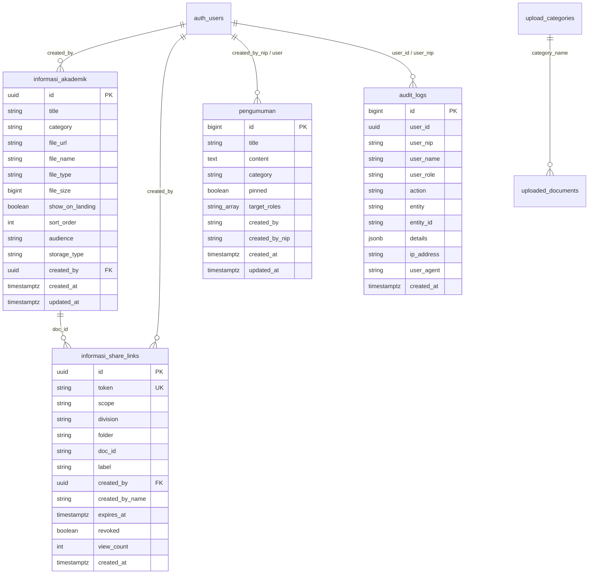

# Dokumentasi Halaman Informasi dan Pengumuman

Dokumentasi ini merangkum secara komprehensif arsitektur teknis, struktur basis data, relasi entitas, matriks hak akses peran (*roles*), fungsi-fungsi sistem, serta standar desain antarmuka (*UI/UX*) untuk modul **Informasi Dokumen** dan **Pengumuman** pada aplikasi ACCA.

---

## 1. Gambaran Umum Modul

Modul Informasi dan Pengumuman dirancang untuk mengelola dan mempublikasikan seluruh dokumen resmi, arsip akademik, pedoman kelembagaan, serta pengumuman berkala kepada seluruh pemangku kepentingan madrasah (Siswa, Guru, Tenaga Kependidikan, Orang Tua/Wali, dan Publik).

### Rute & Halaman Terkait
| Rute Halaman | Hak Akses | Deskripsi |
| :--- | :--- | :--- |
| **`/informasi`** | Publik / Semua Pengguna Terotentikasi | Tampilan portal informasi dokumen publik per divisi (*Akademik*, *Kesiswaan*, *Keasramaan*, *Umum*), fitur pratinjau dokumen, unduhan, dan tombol berbagi. |
| **`/informasi/kelola`** | Pengelola (Admin & Role Terkait) | Halaman terpadu pengelola yang memuat tab **Kelola Informasi** dan tab **Kelola Pengumuman**. |
| **`/informasi/kelola?tab=informasi`** | Pengelola Divisi / Admin | Manajemen folder, urutan dokumen (*reorder*), pengaturan visibilitas, penghapusan, dan pengunggahan berkas via FAB. |
| **`/informasi/kelola?tab=pengumuman`** | Admin / Operator Pengumuman | Manajemen pembuatan, pengeditan, pengaturan target audiens, dan penghapusan pengumuman madrasah. |
| **`/info-link/[token]`** | Publik (Berbasis Token Acak) | Halaman publik penampil dokumen/folder yang dibagikan melalui tautan aman tanpa login. |
| **`/audit-log`** | Administrator / WKM | Halaman mandiri pemantau riwayat jejak audit (*Audit Trail*) untuk seluruh aksi destruktif & perubahan data. |
| **`/pengaturan-users?tab=feature_access`** | Administrator | Konfigurasi granular kontrol akses fitur (*Feature Access*) per divisi dan pengumuman. |

---

## 2. Struktur Tabel Database & Skema Data

Modul ini beroperasi menggunakan PostgreSQL dengan Prisma ORM (`apps/api/prisma/schema.prisma`). Empat tabel utama dan dua tabel pendukung yang digunakan adalah:



### 2.1. Tabel `informasi_akademik`
Menyimpan arsip dokumen informasi seluruh divisi dan representasi folder kategori.

| Kolom | Tipe Data | Nullable | Default | Keterangan |
| :--- | :--- | :--- | :--- | :--- |
| `id` | `UUID` | Tidak | `gen_random_uuid()` | Primary key unik dokumen. |
| `title` | `String` | Tidak | - | Judul dokumen informasi (atau `'Folder placeholder'`). |
| `category` | `String` | Tidak | - | Kategori folder dengan format `[Divisi] Nama Folder`. |
| `file_url` | `String` | Tidak | - | URL publik penyimpanan berkas (Cloudflare R2/S3) atau `'#'` jika placeholder. |
| `file_name` | `String` | Tidak | - | Nama fisik berkas saat diunggah (misal: `Jadwal-KBM.pdf`). |
| `file_type` | `String` | Ya | `null` | MIME type berkas (misal: `application/pdf`). |
| `file_size` | `BigInt` | Ya | `null` | Ukuran berkas dalam satuan bytes. |
| `show_on_landing` | `Boolean` | Ya | `true` | Apakah dokumen diizinkan tampil di portal publik/landing page. |
| `sort_order` | `Int` | Tidak | `999` | Urutan penomoran folder dan berkas saat ditampilkan. |
| `storage_type` | `VarChar(20)`| Ya | `'supabase'` | Penyedia penyimpanan berkas (`supabase`, `r2`, atau `local`). |
| `audience` | `String` | Ya | `'umum'` | Audiens visibilitas dokumen: `'umum'`, `'siswa'`, `'guru'`, atau `'none'`. |
| `created_by` | `UUID` | Ya | `null` | Foreign Key yang merujuk ke tabel `auth_users(id)`. |
| `created_at` | `Timestamptz`| Ya | `now()` | Waktu pengunggahan dokumen. |
| `updated_at` | `Timestamptz`| Ya | `now()` | Waktu pembaruan data terakhir. |

---

### 2.2. Tabel `pengumuman`
Menyimpan pengumuman resmi madrasah beserta sasaran peran audiens.

| Kolom | Tipe Data | Nullable | Default | Keterangan |
| :--- | :--- | :--- | :--- | :--- |
| `id` | `BigInt` | Tidak | `autoincrement()` | Primary key unik pengumuman. |
| `title` | `String` | Tidak | - | Judul pengumuman. |
| `content` | `Text` | Tidak | - | Isi lengkap pengumuman (mendukung format HTML aman tersanitasi). |
| `category` | `VarChar(50)`| Tidak | `'Umum'` | Kategori divisi: `'Umum'`, `'Akademik'`, `'Kesiswaan'`, `'Keasramaan'`. |
| `pinned` | `Boolean` | Tidak | `false` | Status disematkan di paling atas daftar (*sticky announcement*). |
| `target_roles` | `String[]` | Tidak | `[]` | Daftar role target penerima. Jika array kosong `[]`, berarti ditujukan untuk semua role. |
| `created_by` | `String` | Tidak | - | Nama lengkap pembuat pengumuman. |
| `created_by_nip`| `VarChar(50)`| Tidak | - | NIP / Nomor Identitas pembuat pengumuman. |
| `created_at` | `Timestamptz`| Tidak | `now()` | Waktu pembuatan pengumuman. |
| `updated_at` | `Timestamptz`| Tidak | `now()` | Waktu terakhir kali pengumuman diubah. |

---

### 2.3. Tabel `informasi_share_links`
Menyimpan token kriptografis tautan berbagi (*shareable links*) untuk dokumen atau folder ke publik luar sistem.

| Kolom | Tipe Data | Nullable | Default | Keterangan |
| :--- | :--- | :--- | :--- | :--- |
| `id` | `UUID` | Tidak | `gen_random_uuid()` | Primary key tautan berbagi. |
| `token` | `String` | Tidak | - | Token akses unik 32-karakter URL-safe. |
| `scope` | `String` | Tidak | - | Cakupan tautan: `'doc'` (berkas tunggal) atau `'folder'` (satu folder). |
| `division` | `String` | Ya | `null` | Nama divisi (misal: `'Akademik'`). |
| `folder` | `String` | Ya | `null` | Nama folder tujuan berbagi. |
| `doc_id` | `String` | Ya | `null` | ID dokumen jika scope bernilai `'doc'`. |
| `label` | `String` | Ya | `null` | Label deskripsi tautan untuk referensi pembuat. |
| `created_by` | `UUID` | Ya | `null` | ID user pembuat tautan. |
| `created_by_name`| `String` | Ya | `null` | Nama pembuat tautan. |
| `expires_at` | `Timestamptz`| Ya | `null` | Tanggal dan waktu kedaluwarsa (diset `null` karena tautan publik kini permanen). |
| `revoked` | `Boolean` | Tidak | `false` | Kontrol status tautan (`false` = Aktif, `true` = Nonaktif). Pengelola dapat mengaktifkan/menonaktifkan kapan saja. |
| `view_count` | `Int` | Tidak | `0` | Jumlah kunjungan publik yang menggunakan tautan ini. |
| `created_at` | `Timestamptz`| Tidak | `now()` | Waktu pembuatan tautan. |

---

### 2.4. Tabel `audit_logs`
Menyimpan rekam jejak audit forensik (*audit trail*) untuk seluruh aksi penting dan destruktif lintas sistem (penghapusan dokumen, pembersihan/pengubahan folder, penerbitan/pencabutan link berbagi, dan manajemen pengumuman).

| Kolom | Tipe Data | Nullable | Default | Keterangan |
| :--- | :--- | :--- | :--- | :--- |
| `id` | `BigInt` | Tidak | `autoincrement()` | Primary key unik rekam audit. |
| `user_id` | `VarChar(100)`| Ya | `null` | UUID/ID pengguna yang mengeksekusi aksi. |
| `user_nip` | `VarChar(50)` | Ya | `null` | NIP / Username pengguna pelaksana. |
| `user_name` | `VarChar(100)`| Ya | `null` | Nama lengkap pengguna pelaksana. |
| `user_role` | `VarChar(100)`| Ya | `null` | Peran (*role*) pengguna saat aksi dijalankan. |
| `action` | `VarChar(50)` | Tidak | - | Kode aksi (misal: `DELETE_INFORMASI_DOC`, `DELETE_INFORMASI_FOLDER`, `RENAME_INFORMASI_FOLDER`, `DELETE_PENGUMUMAN`, `CREATE_SHARE_LINK`, `REVOKE_SHARE_LINK`, `DELETE_SHARE_LINK`). |
| `entity` | `VarChar(50)` | Tidak | - | Nama entitas yang terpengaruh (`INFORMASI`, `PENGUMUMAN`, `SHARE_LINK`). |
| `entity_id` | `VarChar(100)`| Ya | `null` | Identifier dokumen, folder, pengumuman, atau token link terkait. |
| `details` | `JSONB` | Ya | `null` | Payload rincian konteks teknis (judul dokumen, nama folder, URL berkas, IP, dsb). |
| `ip_address` | `VarChar(64)` | Ya | `null` | Alamat IP jaringan asal pengguna. |
| `user_agent` | `Text` | Ya | `null` | Informasi User-Agent peramban/klien. |
| `created_at` | `Timestamptz`| Tidak | `now()` | Waktu stempel presisi pencatatan aksi. |

Indeks performa: `idx_audit_logs_action`, `idx_audit_logs_entity`, `idx_audit_logs_user_nip`, `idx_audit_logs_created_at`.

---

### 2.5. Tabel Pendukung
1. **`site_settings`**:
   Menyimpan konfigurasi JSON modul kontrol akses pada kolom `key` dan `value`:
   * `informasi_kelola_access_config`: Izin umum kelola informasi.
   * `informasi_akademik_access_config`: Izin divisi Akademik.
   * `informasi_kesiswaan_access_config`: Izin divisi Kesiswaan.
   * `informasi_keasramaan_access_config`: Izin divisi Keasramaan.
   * `informasi_umum_access_config`: Izin divisi Umum/Sarpras/Humas.
   * `pengumuman_access_config`: Izin kelola pengumuman.
2. **`upload_categories` & `uploaded_documents`**:
   Digunakan sebagai lapisan kompatibilitas divisi arsip legacy `Dokumen Unggahan`.

---

## 3. Relasi Data & Mekanisme Arsitektur

### 3.1. Abstraksi Folder & Auto-Placeholder
Di dalam tabel `informasi_akademik`, tidak ada tabel terpisah untuk folder. Folder direpresentasikan melalui kolom `category` dengan format standar:
```
[Nama Divisi] Nama Folder
Contoh: [Akademik] Kurikulum Merdeka
Contoh: [Keasramaan] Tata Tertib Kamar
```
* **Masalah Awal**: Jika sebuah folder hanya memiliki 1 berkas dan berkas tersebut dihapus, maka 0 baris tersisa dengan kategori tersebut, sehingga folder ikut hilang.
* **Solusi Auto-Placeholder**:
  1. Pada fungsi `deleteInformasi(id, user, { keepFolder: true })`, backend menghitung sisa dokumen pada kategori tersebut (`remainingCount`).
  2. Jika sisa dokumen adalah 0, sistem secara otomatis memasukkan baris penanda (*placeholder*):
     `title = 'Folder placeholder'`, `file_url = '#'`, `file_size = 0`.
  3. Folder tetap ada dan dapat dikelola atau diisi kembali.
  4. Ketika berkas baru diunggah (`createInformasi`), sistem secara otomatis menghapus baris placeholder kosong tersebut.
  5. Penghapusan folder secara total hanya terjadi ketika user memilih opsi eksplisit **"Hapus Folder"** (`deleteFolder`).

### 3.2. Hierarki Status Visibilitas Dokumen & Folder
Setiap dokumen memiliki nilai visibilitas:
* `umum`: Terbuka untuk seluruh pengguna dan publik.
* `siswa`: Hanya dapat dilihat oleh pengguna yang memiliki role `SISWA`.
* `guru`: Hanya dapat dilihat oleh pengguna yang memiliki role `GURU` atau staf pendidik.
* `none` (*Sembunyi*): Disembunyikan dari portal publik/pembaca biasa (hanya terlihat oleh pengelola).

Status visibilitas folder dihitung secara dinamis:
* Jika seluruh dokumen bernilai sama $\rightarrow$ Folder menampilkan status tersebut (`Umum`, `Siswa`, `Guru`, atau `Sembunyi`).
* Jika dokumen di dalamnya memiliki visibilitas yang berbeda $\rightarrow$ Folder menampilkan status **`Terbatas`** (dokumen tampil sebagian sesuai hak masing-masing peran).

### 3.3. Sinkronisasi Tautan Berbagi Publik (*Public Share Links*)
Ketika pengelola berinteraksi dengan folder atau dokumen yang memiliki tautan berbagi publik aktif:
1. **Sinkronisasi Pengubahan Nama Folder (*Rename Cascade*)**:
   Jika sebuah folder diubah namanya melalui fitur edit kategori (`updateCategory`), sistem backend membungkus mutasi dalam satu transaksi Prisma:
   * Memperbarui seluruh kolom `category` pada dokumen di tabel `informasi_akademik`.
   * Memperbarui kolom `folder` pada tabel `informasi_share_links` agar tautan publik yang sudah dibagikan sebelumnya tetap mengarah ke folder yang tepat tanpa merusak akses pihak luar.
   * Mencatat aksi `RENAME_INFORMASI_FOLDER` ke dalam `audit_logs`.
2. **Pembersihan Tautan Yatim (*Orphaned Links Cleanup*)**:
   * Saat sebuah berkas dihapus via `deleteInformasi`, semua baris di `informasi_share_links` yang menunjuk ke `doc_id` tersebut otomatis dibersihkan.
   * Saat sebuah folder dihapus permanen via `deleteFolder`, semua tautan berbagi berskup `folder` untuk divisi & folder tersebut otomatis dibersihkan dari basis data.

### 3.4. Jejak Audit Forensik (*Audit Trail*)
Setiap operasi destruktif atau mutasi data sensitif di modul Informasi & Pengumuman otomatis dicatat oleh `AuditService`:
* **Non-Blocking & Resilient**: Proses pencatatan log dibungkus dalam mekanisme *fail-safe* (`try-catch`) sehingga kendala logging tidak akan pernah menggagalkan transaksi bisnis utama pengguna.
* **Aksi yang Dipantau**:
  * `DELETE_INFORMASI_DOC`: Penghapusan berkas informasi individual.
  * `DELETE_INFORMASI_FOLDER`: Penghapusan seluruh folder beserta seluruh dokumen di dalamnya.
  * `RENAME_INFORMASI_FOLDER`: Pengubahan nama folder divisi.
  * `DELETE_PENGUMUMAN`: Penghapusan pengumuman madrasah.
  * `CREATE_SHARE_LINK`: Pembuatan tautan berbagi publik baru.
  * `REVOKE_SHARE_LINK`: Pencabutan / penonaktifan status tautan publik.
  * `DELETE_SHARE_LINK`: Penghapusan permanen tautan dari riwayat.
* **Halaman Mandiri `/audit-log`**: Administrator dan WKM dapat memantau seluruh kronologi aktivitas secara terpusat dengan fitur pencarian teks, filter entitas, filter aksi, dan paginasi interaktif.

---

## 4. Peran Pengguna (*Roles*) & Matriks Hak Akses

Sistem keamanan menerapkan otorisasi berlapis (*Defense-in-Depth*) menggunakan **NestJS Guard**, **Feature Access Engine**, dan **Service-Layer Division Isolation**.

### 4.1. Matriks Akses Peran

| Peran (*Role*) | Akses Portal Informasi (`/informasi`) | Kelola Informasi Akademik | Kelola Informasi Kesiswaan | Kelola Informasi Keasramaan | Kelola Informasi Umum | Kelola Pengumuman |
| :--- | :---: | :---: | :---: | :---: | :---: | :---: |
| **ADMIN / ADMINISTRATOR** | Full (Semua) |  Full |  Full |  Full |  Full |  Full |
| **OP_PENGUMUMAN** | Pembaca | ❌ | ❌ | ❌ | ❌ |  Full |
| **WKM_AKADEMIK** | Full (Semua) |  Full | ❌ | ❌ | ❌ | *Sesuai Izin* |
| **WKM_KESISWAAN** | Full (Semua) | ❌ |  Full | ❌ | ❌ | *Sesuai Izin* |
| **WKM_KEASRAMAAN** | Full (Semua) | ❌ | ❌ |  Full | ❌ | *Sesuai Izin* |
| **WKM_HUMAS** | Full (Semua) | ❌ | ❌ | ❌ |  Full | *Sesuai Izin* |
| **GURU** | Pembaca (Umum + Guru) | ❌ | ❌ | ❌ | ❌ | ❌ |
| **SISWA** | Pembaca (Umum + Siswa) | ❌ | ❌ | ❌ | ❌ | ❌ |
| **ORANG_TUA / TENDIK** | Pembaca (Sesuai Target) | ❌ | ❌ | ❌ | ❌ | ❌ |
| **Publik (Tanpa Login)** | Pembaca (Umum / Token) | ❌ | ❌ | ❌ | ❌ | ❌ |

> [!NOTE]
> Peran bawaan (*hardcoded roles*) seperti `WKM_AKADEMIK`, `WKM_KESISWAAN`, `WKM_KEASRAMAAN`, `WKM_HUMAS`, `OP_PENGUMUMAN`, dan `ADMIN` terlindungi di sistem sehingga tidak dapat dihapus aksesnya secara tidak sengaja melalui antarmuka Feature Access.

### 4.2. Mekanisme Proteksi Backend
1. **NestJS Controller Guard**:
   * Pengumuman: `@FeatureAccess(PENGUMUMAN_KELOLA_KEY, 'OP_PENGUMUMAN')`
   * Informasi: `@FeatureAccess(ALL_INFORMASI_KEYS, ...WKM_INFORMASI)`
2. **Service Layer Division Check (`bolehKelolaDivisi`)**:
   Setiap operasi `createInformasi`, `updateInformasi`, dan `deleteInformasi` memeriksa divisi target dokumen. Pengguna `WKM_KEASRAMAAN` ditolak saat mencoba menyunting atau menghapus dokumen divisi `Akademik`, dan sebaliknya.
3. **Penyaringan Audiens Pengumuman Pengelola (`?manage=true`)**:
   * Endpoint biasa `/api/pengumuman` memfilter berdasarkan role penerima.
   * Endpoint kelola `/api/pengumuman?manage=true` memeriksa fungsi `bolehKelola(user)` dan mengembalikan seluruh arsip pengumuman tanpa memandang role audiens.

---

## 5. Daftar Fitur & Fungsi Antarmuka

### 5.1. Fitur Halaman Informasi Dokumen (`/informasi`)
* **Navigasi Tab Divisi Bersih**: Menyediakan tab **Akademik**, **Kesiswaan**, **Keasramaan**, dan **Umum** yang menampilkan nama tab secara fokus dan rapi (tanpa angka badge jumlah file).
* **Pencarian & Filter Cepat**: Menyaring dokumen dan folder secara instan berdasarkan kata kunci judul dokumen maupun nama folder.
* **Pratinjau PDF Terintegrasi**: Membuka modal [PDFViewer](file:///d:/acca-new/apps/web/components/PDFViewer.tsx) langsung di peramban tanpa memaksa pengguna mengunduh berkas terlebih dahulu.
* **Generator Tautan Berbagi Publik**:
  * Pengguna berwenang dapat menekan tombol berbagi pada berkas atau folder.
  * Tautan publik bersifat permanen (tanpa masa berlaku/kedaluwarsa).
  * Pengelola memiliki kontrol penuh untuk **menonaktifkan** (*deactivate*) dan **mengaktifkan kembali** (*reactivate*) tautan kapan saja tanpa mengubah URL yang sudah terlanjur dibagikan.
  * Dilengkapi tombol hapus permanen dari riwayat dan indikator status *Aktif* / *Nonaktif*.
  * Tautan publik dapat diakses langsung oleh masyarakat/wali tanpa login melalui rute `/info-link/[token]`.
* **Tombol Cepat Pengelola (FAB)**: Tombol melayang *"Kelola Informasi"* hanya muncul jika user yang login memiliki salah satu hak kelola.

### 5.2. Fitur Halaman Kelola Informasi (`/informasi/kelola?tab=dokumen`)
* **Atur Urutan Folder (*Drag & Drop*)**: Memungkinkan pengelola mengubah hierarki urutan folder dengan menyeret (*drag*) kartu folder ke posisi baru; urutan langsung disinkronkan ke kolom `sort_order` di database.
* **Manajemen Folder Cepat**:
  * Menambah folder baru di divisi aktif.
  * Mengubah nama folder (*rename*) secara otomatis memperbarui seluruh berkas di dalam folder tersebut.
  * Menghapus folder beserta seluruh dokumen fisik di Cloudflare R2 / S3 storage secara permanen.
* **Pengaturan Visibilitas Granular**:
  * Mengubah visibilitas di level folder otomatis mendistribusikan hak akses ke seluruh berkas di dalamnya.
  * Mengubah visibilitas per berkas secara individual.
* **Tombol Unggah Terpusat (FAB)**:
  * Menghilangkan ikon unggah redundan di tiap baris folder dan tabel.
  * Menggunakan tombol **FAB (Floating Action Button)** terpusat (`DesktopFab` di kanan bawah desktop dan `MobileFab` di navigasi tengah mobile).
  * Modal unggah menyediakan dropdown pilihan folder tujuan atau opsi membuat folder baru secara instan.
* **Tampilan Folder Kosong**: Menampilkan baris informatif *"Folder ini masih kosong"* saat seluruh berkas telah dipindahkan atau dihapus.

### 5.3. Fitur Halaman Kelola Pengumuman (`/informasi/kelola?tab=pengumuman`)
* **Daftar Pengumuman Lengkap**: Menampilkan judul, kategori, tanggal publikasi, metadata pembuat, dan target penerima.
* **Kolom Target Role Cerdas**:
  * Jika pengumuman ditujukan ke semua pihak, ditampilkan badge netral **"Semua Role"**.
  * Jika ditujukan ke peran tertentu, ditampilkan chip role spesifik (misal: `GURU`, `SISWA`).
* **Modal Tambah & Edit Pengumuman Modern**:
  * Menggunakan standar desain [Modal.tsx](file:///d:/acca-new/apps/web/components/ui/Modal.tsx) dengan varian header dan border tematik.
  * Menggunakan [Button.tsx](file:///d:/acca-new/apps/web/components/ui/Button.tsx) standar (`variant="cancel"` dan `variant="primary"`).
  * Pemilihan kategori menggunakan [InlineSelect.tsx](file:///d:/acca-new/apps/web/components/ui/InlineSelect.tsx).
  * Pilihan radio target publikasi (*Semua Pengguna* vs *Target Role Tertentu* dengan checklist multi-role).
  * Fitur sematkan di paling atas (*Pin Announcement*).
* **Modal Hapus Pengumuman**: Dialog konfirmasi penghapusan permanen pengumuman berukuran ringkas (`size="sm"`, `variant="delete"`).

---

## 6. Arsitektur API Backend & Next.js Proxy

### 6.1. Endpoint Informasi
* `GET /api/informasi-akademik`: Mengambil daftar dokumen informasi (mendukung filter `?role=`, `?category=`, `?admin=true`).
* `POST /api/informasi-akademik`: Mengunggah berkas/membuat record baru atau placeholder folder.
* `PATCH /api/informasi-akademik`: Mengubah visibilitas, urutan sorting, atau mengubah nama folder (*rename category*).
* `DELETE /api/informasi-akademik?id=...`: Menghapus satu dokumen dan menjaga folder tetap bertahan via auto-placeholder.
* `DELETE /api/informasi-akademik?category=...`: Menghapus folder beserta seluruh dokumen di dalamnya secara permanen.
* `GET /api/informasi-akademik/izin-saya`: Mengembalikan daftar divisi yang boleh dikelola oleh user yang sedang aktif.

### 6.2. Endpoint Pengumuman
* `GET /api/pengumuman`: Mengambil pengumuman sesuai filter role pembaca.
* `GET /api/pengumuman?manage=true`: Mengambil seluruh pengumuman untuk tabel kelola pengumuman.
* `POST /api/pengumuman`: Menyimpan pengumuman baru (sanitasi HTML otomatis).
* `PUT /api/pengumuman`: Memperbarui data pengumuman yang ada.
* `DELETE /api/pengumuman?id=...`: Menghapus pengumuman berdasarkan ID.
* `GET /api/pengumuman/izin-saya`: Memeriksa apakah user memiliki hak kelola pengumuman.

### 6.3. Endpoint Upload & Autentikasi
* `POST /api/upload`: Handler pengunggahan berkas ke Cloudflare R2 / S3 storage.
  * **Penyedia Tunggal Aktif (*Cloudflare R2*)**: Cloudflare R2 (S3-compatible) merupakan satu-satunya tujuan penyimpanan berkas aktif sistem ACCA. Permintaan unggah yang mengarah ke penyedia lama (*Google Drive*, *Server Hosting*, dan *Supabase*) secara tegas ditolak dengan instruksi untuk beralih ke Cloudflare R2.
  * **Sanitasi Nama Folder**: Menggunakan regex `/^[a-zA-Z0-9_/\s\-().&,']+$/` yang mendukung spasi, tanda kurung, karakter umum, serta tanda petik satu (`'`) untuk mengakomodasi penamaan bernuansa Islam (misalnya `Al-Qur'an`, `Do'a`), serta secara mutlak menolak upaya *directory traversal* (`..`).
  * **Validasi Berkas & Ekstensi Ketat (*Strict Whitelist & Blacklist*)**:
    * Sistem memblokir berkas eksekutabel dan skrip berbahaya: `.php`, `.phtml`, `.php3`, `.exe`, `.bat`, `.sh`, `.cmd`, `.vbs`, `.ps1`, `.msi`, `.jar`, `.jsp`, `.asp`, `.aspx`.
    * Memproteksi dari potensi serangan ekstensi ganda (*double extensions*, misal `surat.php.pdf`).
    * Memvalidasi whitelist tipe berkas aman: dokumen (`.pdf`, `.doc`, `.docx`, `.xls`, `.xlsx`, `.ppt`, `.pptx`, `.csv`, `.txt`), gambar (`.jpg`, `.jpeg`, `.png`, `.webp`), arsip (`.zip`, `.rar`), serta dokumen web/markup (`.html`, `.htm`).
  * **Isolasi Keamanan File HTML (*Sandboxing*)**:
    * Berkas HTML diizinkan untuk diunggah untuk modul pembelajaran/arsip digital, namun ditolak dari proxy publik bypass.
    * Pada penampil antarmuka pengguna (`PDFViewer.tsx`), file HTML dimuat ke dalam `<iframe>` yang diamankan dengan atribut sandbox ketat:
      `<iframe sandbox="allow-scripts allow-forms allow-popups" ... />`
      Atribut `allow-same-origin` sengaja **ditiadakan**, sehingga berkas HTML tidak dapat membaca cookie sesi, `localStorage`, maupun mengeksekusi skrip dalam konteks domain utama ACCA (pencegahan total *Cross-Site Scripting / XSS*).
  * **Autentikasi Sesi**: Menggunakan `decodeURIComponent` pada cookie `acca_session` dan fallback ke klaim JWT `claims.authId || claims.sub`.
* `DELETE /api/storage/upload?url=...`: Handler penghapusan berkas.
  * **Cloudflare R2**: Berkas fisik dihapus secara permanen via S3 SDK `DeleteObjectCommand`.
  * **Google Drive, Server Hosting & Supabase (Legacy)**: Penghapusan fisik ke server pihak ketiga dilewati (*bypassed*); catatan file di registry dan database tetap dicabut dengan aman tanpa memicu kegagalan jaringan atau ketergantungan API pihak ketiga.

---

## 7. Lokasi File Kunci dalam Kode Sumber

```
acca-new/
├── Dokumentasi Halaman/
│   └── Halaman Informasi dan Pengumuman.md           # Dokumen arsitektur dan panduan lengkap ini
├── apps/
│   ├── api/
│   │   ├── prisma/schema.prisma                       # Skema tabel database (informasi_akademik, pengumuman, share_links, audit_logs)
│   │   └── src/
│   │       ├── auth/feature-access.guard.ts           # Guard kontrol akses fitur & definisi hardcoded roles
│   │       ├── common/
│   │       │   └── audit.service.ts                   # Layanan pencatatan jejak audit forensik (AuditService)
│   │       ├── audit/
│   │       │   ├── audit.controller.ts                # REST Controller untuk riwayat jejak audit (/api/audit-logs)
│   │       │   └── audit.module.ts                    # NestJS Module jejak audit
│   │       ├── informasi/
│   │       │   ├── informasi.controller.ts            # REST Controller informasi dokumen
│   │       │   └── informasi.service.ts               # Logika bisnis, auto-placeholder, proteksi divisi, & sync share links
│   │       └── pengumuman/
│   │           ├── pengumuman.controller.ts           # REST Controller pengumuman (?manage=true)
│   │           └── pengumuman.service.ts              # Logika bisnis, penyaringan target roles, & sanitasi HTML
│   │
│   └── web/
│       ├── app/
│       │   ├── api/
│       │   │   ├── upload/route.ts                    # API upload berkas dengan validasi regex folder aman & ekstensi ketat
│       │   │   ├── audit-logs/
│       │   │   │   └── route.ts                       # Next.js API proxy jejak audit
│       │   │   └── pengumuman/
│       │   │       ├── route.ts                       # Next.js API proxy pengumuman
│       │   │       └── izin-saya/route.ts             # Next.js API proxy izin pengumuman
│       │   ├── informasi/
│       │   │   ├── view.tsx                           # Tampilan portal informasi dokumen publik
│       │   │   ├── useIzinInformasi.ts                # React hook sinkronisasi izin pengelola
│       │   │   ├── informasi.css                      # Styling khusus halaman informasi dan pengumuman
│       │   │   ├── components/
│       │   │   │   └── ShareInformasiModal.tsx        # Modal bagikan informasi (link internal & publik)
│       │   │   ├── kelola/
│       │   │   │   └── view.tsx                       # Halaman shell tab Kelola Informasi & Pengumuman
│       │   │   └── tabs/
│       │   │       ├── KelolaInformasiTab.tsx         # Tab kelola dokumen, urutan folder, & FAB upload
│       │   │       └── KelolaPengumumanTab.tsx        # Tab kelola pengumuman & modal terpadu
│       │   ├── audit-log/
│       │   │   └── view.tsx                           # Halaman UI pemantau jejak audit mandiri (/audit-log)
│       │   └── pengaturan-users/
│       │       └── tabs/FeatureAccessTab.tsx          # Antarmuka pengelolaan Feature Access 5 modul
│       ├── components/
│       │   ├── PDFViewer.tsx                          # Penampil dokumen dengan sandbox iframe aman untuk HTML
│       │   ├── ui/
│       │   │   ├── Modal.tsx                          # Komponen dialog bersama (Modal, ModalBody, ModalField, ModalFooter)
│       │   │   ├── Button.tsx                         # Komponen tombol seragam dengan varian cancel/primary/danger
│       │   │   ├── InlineSelect.tsx                   # Dropdown ringkas seragam untuk kontrol tabel dan modal
│       │   │   ├── ActionButtons.tsx                  # Tombol aksi ikonik (edit, delete)
│       │   │   └── DesktopFab.tsx                     # Tombol floating action button melayang desktop
│       │   └── mobile/
│       │       └── MobileFab.tsx                      # Tombol floating action button navigasi mobile
│       └── lib/
│           ├── api-auth.ts                            # Validasi token pengguna API dengan fallback claims.sub
│           ├── app-jwt.ts                             # Utilitas dekode cookie sesi dan autentikasi request
│           └── informasi/
│               └── docs.ts                            # Utilitas & pemetaan peran divisi informasi (ROLE_NAME_MAP)
```

---
*Dokumentasi ini dibuat dan diselaraskan secara akurat dengan implementasi kode sumber per September 2026.*
